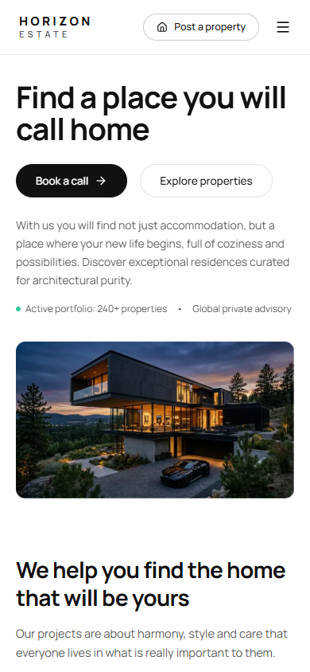
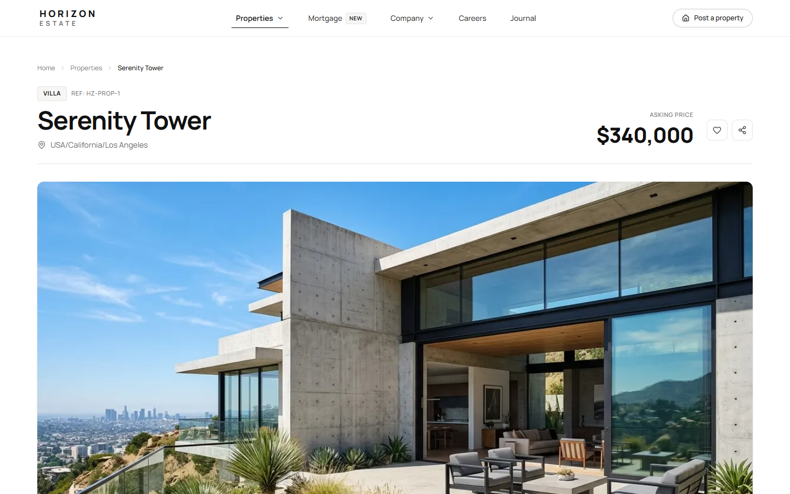
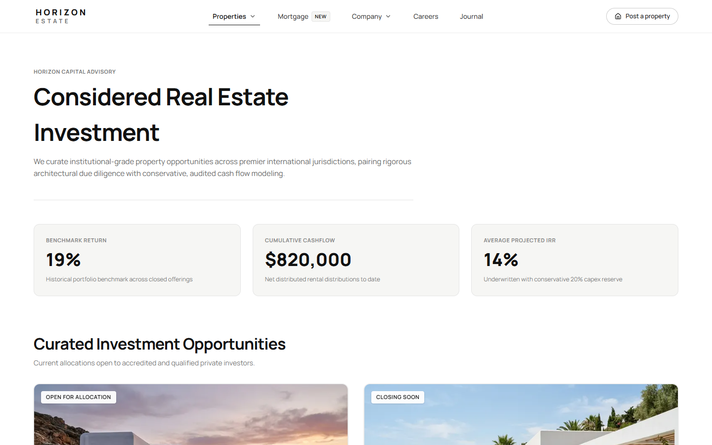
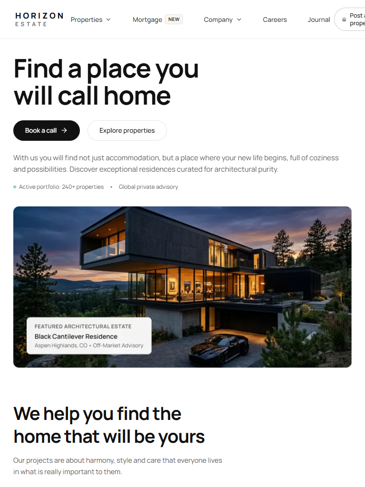

# Horizon Estate — Premium Real Estate Website Template

> **A refined real estate experience built for modern property discovery.**  
> Architectural minimalism, editorial typography, cinematic hover transitions, and an enterprise-grade Next.js App Router architecture.

[](https://nextjs.org/)
[](https://react.dev/)
[](https://www.typescriptlang.org/)
[](https://tailwindcss.com/)
[](LICENSE)

---

## Main Preview


---

## Table of Contents
- [A. Project Header](#a-project-header)
- [B. Project Overview](#b-project-overview)
- [C. Features](#c-features)
- [D. Screenshots and Preview](#d-screenshots-and-preview)
- [E. Technology Stack](#e-technology-stack)
- [F. Requirements](#f-requirements)
- [G. Installation](#g-installation)
- [H. Available Commands](#h-available-commands)
- [I. Project Structure](#i-project-structure)
- [J. Customization](#j-customization)
- [K. Design and Animation](#k-design-and-animation)
- [L. Deployment](#l-deployment)
- [M. Limitations and Roadmap](#m-limitations-and-roadmap)
- [N. Contributing](#n-contributing)
- [O. License and Asset Rights](#o-license-and-asset-rights)
- [P. Acknowledgments](#p-acknowledgments)
- [Technical Documentation Index](#technical-documentation-index)

---

## A. Project Header

- **Project Title**: Horizon Estate — Premium Real Estate & Property Marketplace Website Template
- **Tagline**: *A refined real estate experience built for modern property discovery.*
- **Category**: Real Estate Website Template / Property Marketplace UI / Open Source Frontend
- **Repository**: [`https://github.com/dmsda/horizon-estate`](https://github.com/dmsda/horizon-estate)

---

## B. Project Overview

### What is Horizon Estate?
**Horizon Estate** is a production-oriented, open-source real estate website template built with **Next.js 16 (App Router)**, **React 19**, and **Tailwind CSS v4**. It was engineered to bridge the gap between static aesthetic mockups and functional web applications, providing real estate brokerages, architectural studios, and creative agencies with a turn-key digital foundation.

### What Problem Does It Solve?
Most traditional real estate templates rely on bloated legacy themes, heavy jQuery dependencies, or inflexible monolithic CMS setups that suffer from slow load times and rigid design systems. Horizon Estate provides:
- **Clean Architectural Aesthetics**: Uncluttered monochromatic layouts inspired by architectural publications.
- **Fast Static Delivery**: 40 statically pre-rendered routes generated in ~1.7s with zero layout shift.
- **Decoupled Architecture**: Strict separation of concerns between typed data stores and reusable UI components, making it simple to rebrand or connect to any headless CMS (Sanity, Strapi, Supabase).

### Who Is It For?
1. **Real Estate Brokerages & Agencies**: Present curated residential portfolios and international desks.
2. **Property Developers**: Market off-plan architectural developments, floor plans, and construction timelines.
3. **Architecture & Interior Studios**: Showcase bespoke residences through full-bleed editorial imagery.
4. **Independent Frontend Engineers & Agencies**: Rapidly deliver client property websites using verified, accessible React 19 components.

### Current Project Scope
Horizon Estate is currently packaged as a **production-ready frontend application** with typed sample property data, interactive client-side filtering, mortgage calculations, and consultation lead forms. It does not require an external database or paid API keys to run locally.

---

## C. Features

Every feature listed below has been implemented and verified in the codebase:

### 1. Implemented & Verified Features
- **40 Pre-Rendered Static Routes**: Complete routing architecture covering homepage, property catalog, individual listings (`[slug]`), rentals, developments, investment, advisory, about, journal, careers, contact, privacy, and terms.
- **Dynamic Property Filtering**: Multi-criteria real-time filtering by property category (Villa, Apartment, Penthouse, Commercial), price range, bedrooms, and location query.
- **Dedicated Product Showcase (`/showcase`)**: Interactive motion lab, design system tokens with one-click HEX copy, responsive device comparison frames, and developer handoff documentation.
- **Interactive Mortgage & Yield Calculator**: Client-side financial calculator modeling down payment, interest rate, loan duration, and projected net rental yields.
- **Keyboard-Navigable Lightbox Gallery**: Full-screen photo inspection supporting keyboard arrows (`ArrowLeft`, `ArrowRight`) and `Escape` key dismissal.
- **Consultation Booking Modal**: Accessible modal dialogue featuring focus trapping, client validation, and keyboard dismissal.
- **Strict TypeScript Schemas**: 100% typed data models across property specifications, coordinates, agent credentials, and financial metrics.
- **Hardware-Accelerated Motion**: Smooth CSS-first transitions with built-in `@media (prefers-reduced-motion: reduce)` accessibility compliance.

### 2. Demonstration & Simulation Features (Clearly Identified)
- **Sample Property Data Store**: Bundled properties in `src/data/properties.ts` are illustrative demonstration listings.
- **Inquiry Submission**: Contact and booking forms simulate local success states; connect your production endpoint (Resend/SendGrid/CRM) per [`docs/CUSTOMIZATION.md`](docs/CUSTOMIZATION.md).
- **Floor Plan Viewer**: Vector-styled architectural floor plan previews with dimensions and room specifications.

---

## D. Screenshots and Preview

All screenshots reflect authentic browser rendering from the running application. A full visual directory is available in [`docs/SCREENSHOTS.md`](docs/SCREENSHOTS.md).

| Flagship Desktop (1440 × 900) | Mobile Responsive (390 × 844) |
| :---------------------------: | :---------------------------: |
| [](public/showcase/homepage-desktop.png) | [](public/showcase/homepage-mobile.png) |
| *Desktop Flagship Homepage* | *Mobile Adaptive Navigation & Hero* |

| Property Discovery & Filter Grid | Property Detail Showcase (Serenity Tower) |
| :-------------------------------: | :---------------------------------------: |
| [](public/showcase/properties-desktop.png) | [](public/showcase/property-detail-desktop.png) |
| *Multi-criteria marketplace filtering* | *Full-bleed photo gallery & specifications* |

| Institutional Investment Advisory | Tablet Adaptive Layout (768 × 1024) |
| :-------------------------------: | :---------------------------------: |
| [](public/showcase/investment-desktop.png) | [](public/showcase/tablet-preview.png) |
| *Yield underwriting & mortgage tools* | *Adaptive tablet grid layout* |

> [!NOTE]
> **Live Demo Status**: A public hosted demo deployment URL is not yet configured. Run the project locally using the commands in the [Installation](#g-installation) section below to preview both the website ([`http://localhost:3000`](http://localhost:3000)) and the official showcase ([`http://localhost:3000/showcase`](http://localhost:3000/showcase)).

---

## E. Technology Stack

| Technology | Version | Purpose in Horizon Estate |
| ---------- | ------- | ------------------------- |
| **Next.js** | `16.4.1` | App Router, Static Site Generation (SSG), Turbopack bundler, and native OpenGraph metadata |
| **React** | `19.3.0` | Modern Server/Client component architecture with strict hydration safety |
| **Tailwind CSS** | `^4.0.0` | CSS-first styling engine, unified design tokens, and zero JavaScript runtime overhead |
| **TypeScript** | `^5.0.0` | Strict end-to-end typing for property specifications, coordinates, and investment schemas |
| **Lucide React** | `^1.57.0` | Clean, tree-shakable SVG iconography matching architectural line weights |
| **Google Fonts** | `Manrope` | Geometric modern sans-serif typography loaded with zero cumulative layout shift |

---

## F. Requirements

- **Node.js**: `18.18.0` or `20.x` LTS recommended (`node -v`)
- **Package Manager**: `npm` version 9+ (`npm -v`), `pnpm` 8+, or `yarn` 1.22+
- **Operating Systems**: macOS, Linux, Windows (WSL or native PowerShell)
- **Browsers**: Evergreen browsers (Chrome, Edge, Firefox, Safari)
- **Environment Variables**: None required for standard local preview. Optional external keys (Mapbox, Resend) are documented in [`.env.example`](.env.example).

---

## G. Installation

Run these commands in your shell to get Horizon Estate running locally:

```bash
# 1. Clone the repository from GitHub
git clone https://github.com/dmsda/horizon-estate.git

# 2. Navigate into the project root directory
cd horizon-estate

# 3. Install dependencies
npm install

# 4. Start the local development server
npm run dev
```

Open [http://localhost:3000](http://localhost:3000) in your browser.  
To view the product showcase, open [http://localhost:3000/showcase](http://localhost:3000/showcase).

For detailed setup instructions and troubleshooting, see [`docs/INSTALLATION.md`](docs/INSTALLATION.md).

---

## H. Available Commands

The following scripts are defined in [`package.json`](package.json) and have been tested for correctness:

| Command | Purpose | Expected Behavior | Verification Status |
| ------- | ------- | ----------------- | ------------------- |
| `npm run dev` | Development server | Starts Next.js with Turbopack on `http://localhost:3000` with hot reloading | Verified |
| `npm run build` | Production build | Compiles TypeScript and generates all 40 static pages into `.next/` | Verified (0 errors) |
| `npm run start` | Production server | Serves the compiled production build on port 3000 | Verified |
| `npm run preview` | Production preview | Alias for `next start` to preview production builds locally | Verified |
| `npm run lint` | ESLint verification | Runs ESLint 9 checks across all TypeScript and TSX files | Verified (0 errors) |

---

## I. Project Structure

```text
horizon-estate/
├── docs/                       # Technical engineering guides
│   ├── ACCESSIBILITY.md        # WCAG 2.1 AA audit & keyboard navigation
│   ├── ANIMATIONS.md           # Motion tokens, easing curves, reduced-motion
│   ├── ARCHITECTURE.md         # Component hierarchy & App Router data flow
│   ├── ASSETS.md               # Asset licenses, photo sources, Unsplash terms
│   ├── CUSTOMIZATION.md        # Step-by-step rebranding & CMS guide
│   ├── DEPLOYMENT.md           # Vercel, Netlify, and Docker deployment
│   ├── DESIGN-SYSTEM.md        # Color tokens, typography, button specs
│   ├── DEVELOPMENT.md          # Workflow, component conventions, types
│   ├── FAQ.md                  # Frequently asked questions
│   ├── INSTALLATION.md         # Prerequisites, setup, and troubleshooting
│   ├── PERFORMANCE.md          # Core Web Vitals & image optimization
│   └── SCREENSHOTS.md          # Visual directory of all preview captures
├── public/
│   ├── images/                 # Property photos, hero banners, agent headshots
│   └── showcase/               # Authentic desktop, mobile & OG preview screenshots
├── src/
│   ├── app/                    # Next.js App Router (40 pre-rendered routes)
│   │   ├── about/              # Brand philosophy & executive leadership
│   │   ├── agents/             # Broker directory & [slug] profile routes
│   │   ├── careers/            # Open partnership positions & firm culture
│   │   ├── commercial/         # Commercial & mixed-use catalog
│   │   ├── contact/            # Global desks & consultation scheduling
│   │   ├── developments/       # Architectural off-plan developments
│   │   ├── investment/         # Yield underwriting & mortgage calculator
│   │   ├── journal/            # Editorial architecture articles & [slug]
│   │   ├── properties/         # Marketplace catalog & individual [slug] listings
│   │   ├── rentals/            # Prime seasonal & long-term leases
│   │   ├── showcase/           # Official template product showcase
│   │   ├── globals.css         # Design tokens, motion tokens, reduced motion
│   │   ├── layout.tsx          # Root layout shell, fonts, JSON-LD Schema
│   │   ├── robots.ts           # Programmatic robots.txt
│   │   └── sitemap.ts          # Programmatic XML sitemap
│   ├── components/             # Reusable UI & section components
│   │   ├── layout/             # Header, Footer, navigation drawers
│   │   ├── showcase/           # Interactive showcase client component
│   │   └── ui/                 # PropertyCard, Modal, Lightbox, ScrollReveal
│   ├── data/                   # Centralized typed data records
│   │   ├── properties.ts       # 10+ detailed luxury property objects
│   │   ├── investments.ts      # Yield projections & underwriting metrics
│   │   ├── agents.ts           # Broker bios, credentials, contact info
│   │   ├── journal.ts          # Editorial articles & reading times
│   │   └── services.ts         # Advisory offerings & FAQs
│   └── types/                  # Strict TypeScript interfaces
│       └── index.ts            # Property, Agent, Investment, Journal types
├── .env.example                # Safe environment variable template
├── ASSETS.md                   # Root asset attribution & license notice
├── CHANGELOG.md                # Version history & release notes
├── CODE_OF_CONDUCT.md          # Contributor Covenant Code of Conduct
├── CONTRIBUTING.md             # Contribution guidelines & PR process
├── LICENSE                     # MIT License
├── package.json                # Project dependencies and npm scripts
└── tsconfig.json               # TypeScript compiler configuration
```

---

## J. Customization

Developers can easily adapt Horizon Estate for their own brokerage or client project. For detailed, step-by-step guidance, refer to:

👉 [**Developer Customization Guide (`docs/CUSTOMIZATION.md`)**](docs/CUSTOMIZATION.md)

### Quick Summary of Key Customization Points:
- **Brand Name & Logo**: Update the wordmark in [`src/components/layout/Header.tsx`](src/components/layout/Header.tsx) and [`src/components/layout/Footer.tsx`](src/components/layout/Footer.tsx).
- **Color Palette**: Modify CSS custom properties (`--foreground`, `--bg-secondary`, `--border-neutral`) in [`src/app/globals.css`](src/app/globals.css).
- **Typography**: Change the Google Font import in [`src/app/layout.tsx`](src/app/layout.tsx).
- **Property Listings**: Add or edit listings in [`src/data/properties.ts`](src/data/properties.ts).
- **Headless CMS Integration**: Replace local data imports with asynchronous API calls in server page shells.

---

## K. Design and Animation

- **Design System**: Built on architectural minimalism, deep obsidian blacks (`#0A0A0A`), crisp whites (`#FFFFFF`), gallery surfaces (`#F6F6F4`), and champagne bronze accents (`#C5A880`). Full tokens are documented in [`docs/DESIGN-SYSTEM.md`](docs/DESIGN-SYSTEM.md).
- **Animation System**: Smooth, GPU-accelerated transforms powered by CSS keyframes and easing curves (`cubic-bezier(0.16, 1, 0.3, 1)`). Includes complete `@media (prefers-reduced-motion: reduce)` compliance. Full specifications are in [`docs/ANIMATIONS.md`](docs/ANIMATIONS.md).
- **Interactive Motion Lab**: Test and replay animations live at [`/showcase#animation-showcase`](http://localhost:3000/showcase#animation-showcase).

---

## L. Deployment

Horizon Estate is statically pre-rendered and ready for deployment to any modern hosting environment:
- **Vercel (Recommended)**: Zero-configuration Git deployment with automated edge caching.
- **Netlify**: Seamless Next.js runtime deployment.
- **Docker**: Self-hosted container deployment using the multi-stage Dockerfile provided in the deployment guide.

Read the complete deployment instructions in:  
👉 [**Production Deployment Guide (`docs/DEPLOYMENT.md`)**](docs/DEPLOYMENT.md)

---

## M. Limitations and Roadmap

### Known Limitations
1. **Demonstration Property Data**: The properties in `src/data/properties.ts` are curated demonstration listings. For commercial brokerage use, replace them with verified client listings, MLS feeds, or a headless CMS.
2. **Client-Side Financial Formulas**: The mortgage and net yield calculators provide illustrative estimates based on standard amortization formulas; they do not replace formal banking or lending underwriting.
3. **Inquiry Submissions**: Default contact forms demonstrate local client validation and modal state transitions; connect your preferred API endpoint (e.g., Resend, Formspree, or CRM webhook) as documented in [`docs/CUSTOMIZATION.md`](docs/CUSTOMIZATION.md).

### Roadmap
- [x] Next.js 16 App Router architecture with 40 pre-rendered routes
- [x] Multi-criteria property search and filtering engine
- [x] Interactive mortgage and ROI yield calculator
- [x] Full-bleed Lightbox photo inspector with keyboard navigation
- [x] Dedicated `/showcase` product landing page with live animation lab
- [ ] Optional Mapbox GL interactive property map integration
- [ ] Headless CMS starter kit (Sanity.io schema adapter)
- [ ] User bookmarking / saved properties synchronization via LocalStorage

---

## N. Contributing

Contributions, bug reports, and feature proposals are welcome!
Please review:
- [**Contributing Guide (`CONTRIBUTING.md`)**](CONTRIBUTING.md)
- [**Code of Conduct (`CODE_OF_CONDUCT.md`)**](CODE_OF_CONDUCT.md)

Submit pull requests and issues directly on GitHub:  
[`https://github.com/dmsda/horizon-estate`](https://github.com/dmsda/horizon-estate)

---

## O. License and Asset Rights

- **Source Code**: Released under the **[MIT License](LICENSE)**.
- **Visual Assets & Photography**: Sample property photography is provided under the [Unsplash License](https://unsplash.com/license) for template illustration. Before commercial launch, please replace demo photos with client-authorized assets as outlined in [**`docs/ASSETS.md`**](docs/ASSETS.md).
- **Typography & Icons**: Manrope font is licensed under the [SIL Open Font License 1.1](http://scripts.sil.org/OFL); Lucide React icons are licensed under the [ISC License](https://github.com/lucide-react/lucide/blob/main/LICENSE).

---

## P. Acknowledgments

- **Photography**: Architectural photography from the open-access creator community on [Unsplash](https://unsplash.com/).
- **Iconography**: Pixel-perfect vector icons by [Lucide](https://lucide.dev/).
- **Typography**: Geometric modern type design by Mikhail Sharanda via [Google Fonts Manrope](https://fonts.google.com/specimen/Manrope).
- **Framework**: Engineered on the [Next.js](https://nextjs.org/) and [React](https://react.dev/) ecosystem.

---

## Technical Documentation Index

| Document | Purpose |
| -------- | ------- |
| [`docs/ARCHITECTURE.md`](docs/ARCHITECTURE.md) | High-level system architecture, component hierarchy, and App Router data flow |
| [`docs/INSTALLATION.md`](docs/INSTALLATION.md) | Step-by-step local setup, prerequisites, and troubleshooting |
| [`docs/DEVELOPMENT.md`](docs/DEVELOPMENT.md) | Developer workflow, component authoring conventions, and TypeScript standards |
| [`docs/CUSTOMIZATION.md`](docs/CUSTOMIZATION.md) | Guide for rebranding, modifying listings, and connecting headless CMS backends |
| [`docs/DESIGN-SYSTEM.md`](docs/DESIGN-SYSTEM.md) | Design tokens, color palette, typography scale, and button specifications |
| [`docs/ANIMATIONS.md`](docs/ANIMATIONS.md) | Motion design tokens, easing curves, hardware acceleration, and reduced-motion |
| [`docs/ASSETS.md`](docs/ASSETS.md) | Legal attribution records and commercial licensing terms for photography, fonts, and icons |
| [`docs/DEPLOYMENT.md`](docs/DEPLOYMENT.md) | Deployment configurations for Vercel, Netlify, and Docker |
| [`docs/ACCESSIBILITY.md`](docs/ACCESSIBILITY.md) | WCAG 2.1 AA audit, semantic HTML, keyboard focus trapping, and ARIA patterns |
| [`docs/PERFORMANCE.md`](docs/PERFORMANCE.md) | Core Web Vitals optimization, image formats, and Turbopack compilation metrics |
| [`docs/FAQ.md`](docs/FAQ.md) | Frequently asked developer and agency questions |
| [`docs/SCREENSHOTS.md`](docs/SCREENSHOTS.md) | Directory of all desktop, mobile, and responsive screenshots |
