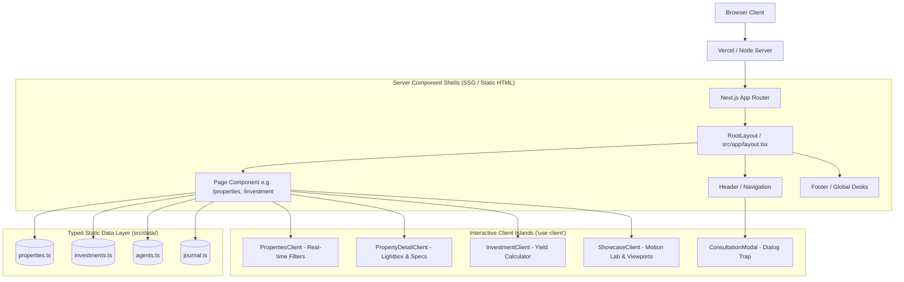
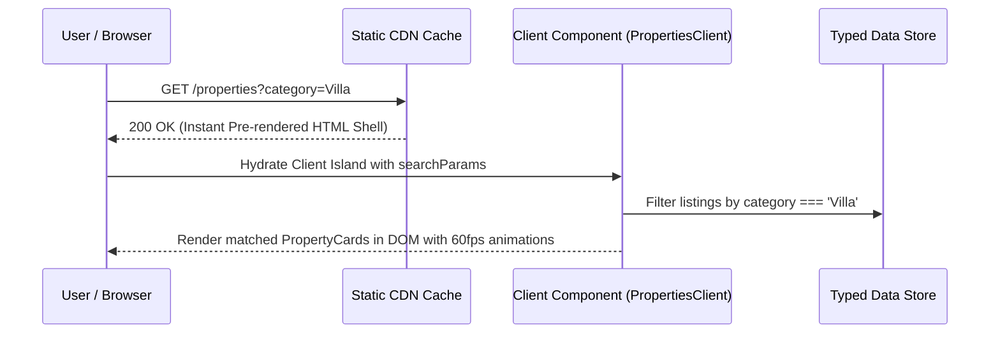

# Horizon Estate — Architecture & Engineering Specification

This document provides a comprehensive technical breakdown of **Horizon Estate**, detailing its framework paradigm, component hierarchy, routing model, state management, styling engine, and rendering pipeline.

---

## 1. High-Level Architecture Overview

Horizon Estate is architected as an **App Router** application built on **Next.js 16.4.1**, **React 19.3.0**, and **Tailwind CSS v4**. It follows a **Server Component First** philosophy, utilizing static site generation (SSG) for all core content routes while isolating interactive client state to the leaf boundaries of the component tree.



---

## 2. Rendering Strategy & Route Model

All 40 application routes are statically pre-rendered at build time:
- **Zero Server Latency**: Pages are emitted as static HTML + JSON payloads, enabling instant global CDN distribution.
- **Dynamic Parameter Prerendering (`generateStaticParams`)**:
  - Individual property listings: `/properties/[slug]` (e.g. `/properties/serenity-tower`, `/properties/island-retreat`).
  - Agent dossiers: `/agents/[slug]` (e.g. `/agents/olivia-barnes`, `/agents/carlos-garcia`).
  - Architectural journal entries: `/journal/[slug]`.
- **Search Parameter Hydration**: Query parameters (e.g., `/properties?type=buy&country=Greece&price=All+prices`) are evaluated client-side via React 19's `useSearchParams()` without requiring dynamic server-side rendering (SSR).



---

## 3. Directory Structure & Separation of Concerns

```text
src/
├── app/                        # Next.js App Router root
│   ├── layout.tsx              # Root HTML shell, fonts, JSON-LD Schema
│   ├── page.tsx                # Homepage flagship composition
│   ├── globals.css             # Tailwind v4 import, CSS custom properties, tokens
│   ├── sitemap.ts              # Programmatic XML sitemap generator
│   ├── robots.ts               # Programmatic robots.txt generator
│   ├── properties/             # Properties catalog & [slug] routes
│   ├── rentals/                # Prime lease catalog
│   ├── developments/           # Architectural off-plan projects
│   ├── investment/             # Yield advisory & mortgage desk
│   ├── showcase/               # Official product showcase & motion lab
│   └── (corporate routes)/     # about, services, careers, contact, privacy, terms
├── components/                 # Reusable UI component modules
│   ├── layout/                 # Header, Footer, navigation drawers
│   ├── home/                   # HeroSection, PropertySearchPanel, InvestmentSection
│   ├── properties/             # PropertiesClient, PropertyDetailClient
│   ├── agents/                 # AgentProfileClient, AgentCard
│   ├── investment/             # InvestmentClient, ROI charts
│   ├── showcase/               # ShowcaseClient, Viewport switcher, Token viewer
│   └── ui/                     # PropertyCard, ConsultationModal, Lightbox, ScrollReveal
├── data/                       # Centralized TypeScript data records
│   ├── properties.ts           # 10+ detailed luxury property objects
│   ├── investments.ts          # Yield projections, underwriting assumptions
│   ├── agents.ts               # Broker credentials, contacts, bios
│   ├── journal.ts              # Architectural editorial articles
│   ├── services.ts             # Advisory services & FAQs
│   └── testimonials.ts         # Client statements
└── types/                      # Strict TypeScript interfaces
    └── index.ts                # Property, Agent, Investment, Journal interfaces
```

---

## 4. Component Architecture & Patterns

### 4.1 Server vs. Client Boundary Rules
- **Server Components (Default)**: All `page.tsx` files and static layout wrappers are Server Components. They read directly from `@/data` and pass structured props down.
- **Client Components (`'use client'`)**: Used exclusively when the component requires:
  - React State (`useState`, `useReducer`).
  - React Effects (`useEffect`, `useCallback`, `useRef`).
  - Browser DOM events (`onClick`, `onChange`, keyboard navigation).
  - Browser APIs (`IntersectionObserver`, `window.matchMedia`, `navigator.clipboard`).

### 4.2 Strict Typing via TypeScript
All data entities are strictly validated against contracts declared in [`src/types/index.ts`](../src/types/index.ts). For example, every property must satisfy the `Property` interface:

```typescript
export interface Property {
  id: string;
  slug: string;
  title: string;
  tagline: string;
  category: 'Villa' | 'Apartment' | 'Penthouse' | 'Commercial' | 'Chalet' | 'Estate';
  price: number;
  formattedPrice: string;
  location: {
    address: string;
    city: string;
    state?: string;
    country: string;
    coordinates?: { lat: number; lng: number };
  };
  specs: {
    bedrooms: number;
    bathrooms: number;
    areaSqFt: number;
    areaSqM: number;
    propertyType: string;
    yearBuilt?: number;
  };
  images: string[];
  featured?: boolean;
  status: 'For Sale' | 'For Rent' | 'Under Offer' | 'Sold';
}
```

---

## 5. Styling Architecture

Horizon Estate utilizes **Tailwind CSS v4** with a modern CSS-first configuration:
- **No JavaScript Configuration File**: Styling is driven by `@import "tailwindcss";` in [`src/app/globals.css`](../src/app/globals.css).
- **CSS Custom Properties**: Design tokens are centralized in `:root` and automatically inherited across all component scopes:
  - Colors: `--background`, `--foreground`, `--bg-secondary`, `--text-secondary`, `--border-neutral`.
  - Motion: `--duration-micro` (180ms), `--duration-ui` (240ms), `--duration-reveal` (600ms), `--ease-architectural`.
- **Zero Runtime Overhead**: Tailwind v4 compiles styles statically at build time into pure CSS rules, avoiding runtime CSS-in-JS style injection.

---

## 6. Animation & Motion Architecture

1. **Hardware Accelerated Transitions**: All motion relies on GPU-friendly properties: `transform` (translate, scale) and `opacity`. Layout-triggering properties (`width`, `height`, `top`, `margin`) are avoided during animations.
2. **Intersection Observer Engine (`ScrollReveal`)**:
   - Uses native `IntersectionObserver` to detect viewport intersection with a -40px threshold margin.
   - Automatically unobserves elements once revealed to release browser memory.
3. **Full Reduced-Motion Support**:
   - The `@media (prefers-reduced-motion: reduce)` media query overrides all transition and animation durations to `0.01ms`.
   - JavaScript motion observers verify `window.matchMedia('(prefers-reduced-motion: reduce)').matches` before scheduling reveals.

---

## 7. Asset Optimization Pipeline

- **Next.js Image Optimizer**: All visual imagery uses `next/image` with predefined `sizes` attributes matching responsive breakpoints.
- **Modern Formats**: Automatically converts JPEG/PNG assets into **WebP** and **AVIF** formats based on the client browser's `Accept` headers.
- **Layout Shift Prevention**: Explicit width/height aspect ratios (`aspect-[16/10]`, `aspect-[4/3]`) ensure zero Cumulative Layout Shift (CLS).

---

## 8. External Headless Integration Readiness

The architecture isolates data access into `src/data/`, which allows developers to switch from static mock files to any headless CMS (Sanity, Strapi, Contentful) or database (Supabase, PostgreSQL) by modifying the data-fetching layer without changing UI components. See [`docs/CUSTOMIZATION.md`](CUSTOMIZATION.md) for step-by-step instructions.
